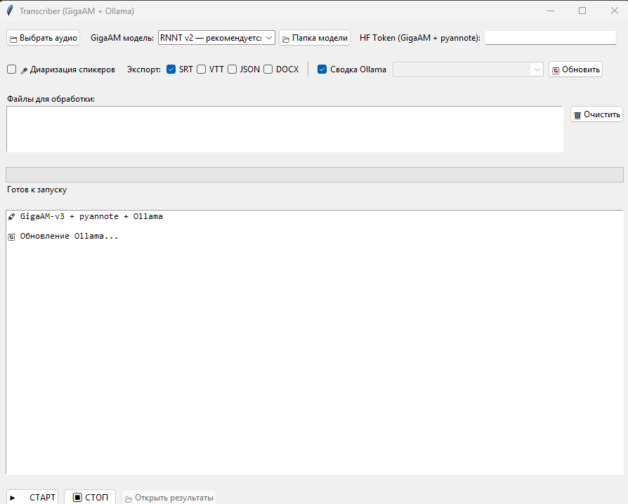

# Transcriber

Локальная транскрибация русской речи с GUI (Tkinter):

- **GigaAM-v3** (Сбер) — распознавание речи
- **pyannote** — диаризация (разделение говорящих), опционально
- **Ollama** — саммари транскрипта локальной LLM, опционально
- Экспорт: TXT, SRT, VTT, JSON, DOCX



## Установка

Проверено на Windows 11, Python 3.10. Если mp3 не открываются, установите [ffmpeg](https://ffmpeg.org/) и добавьте его в `PATH`.

```bat
python -m venv venv
venv\Scripts\activate

:: 1. PyTorch (с GPU; для CPU уберите --index-url)
pip install torch==2.8.0 torchaudio==2.8.0 --index-url https://download.pytorch.org/whl/cu128

:: 2. остальные зависимости
pip install -r requirements.txt

:: 3. GigaAM без проверки зависимостей (пакет заявляет torch<=2.5.1, но с 2.8 работает)
pip install gigaam==0.1.0 --no-deps
```

Для саммари установите [Ollama](https://ollama.com/) и скачайте любую модель, например `ollama pull mistral:7b`.

## Запуск

```bat
start.bat
```

Нужен Python-окружение `venv` рядом с `main.py` (скрипт сам переключается на него).

Токен HuggingFace для pyannote берётся из переменной окружения:

```bat
setx HF_TOKEN "hf_..."
```

## Структура

| Файл | Назначение |
|---|---|
| `main.py` | загрузка моделей, пайплайн, GUI |
| `app_config.py` | сохранение и загрузка настроек |
| `exports.py` | разбор таймкодов, экспорт SRT/VTT/JSON/DOCX |
| `ollama_utils.py` | поиск локальных моделей Ollama |
| `requirements.txt` | зависимости с порядком установки |
| `tests/` | тесты (`pip install pytest`, затем `pytest tests`) |

`gigaam_config.json` создаётся приложением (пути к записям, выбор моделей) и не хранится в git.

## Лицензии и условия использования сторонних моделей

Этот репозиторий содержит только код приложения (MIT, см. `LICENSE`). Модели и библиотеки в него **не входят** и скачиваются отдельно. Сведения ниже проверены по страницам проектов на октябрь 2026; перед использованием сверьтесь с актуальными версиями.

| Компонент | Лицензия | Что важно |
|---|---|---|
| GigaAM (код, [salute-developers/GigaAM](https://github.com/salute-developers/GigaAM)) | MIT | Авторы просят цитировать их статьи при научном использовании (это просьба, не условие лицензии). |
| GigaAM-v3 (веса, [ai-sage/GigaAM-v3](https://huggingface.co/ai-sage/GigaAM-v3)) | MIT | Ограничений на коммерческое использование не заявлено. |
| pyannote/speaker-diarization-3.1 | MIT | Gated-доступ на Hugging Face (см. ниже). |
| pyannote/segmentation-3.0 | MIT | Gated-доступ, условия нужно принять отдельно. |
| pyannote/wespeaker-voxceleb-resnet34-LM (эмбеддинги, используется внутри пайплайна) | CC BY 4.0 | Требуется указание авторства; по описанию модели следует лицензии датасета VoxCeleb. |
| Ollama / mistral:7b | Apache 2.0 (модель) | Другие модели Ollama имеют свои лицензии. |

### Доступ к pyannote

Лицензия моделей pyannote свободная (MIT), но файлы закрыты «воротами» (gating): чтобы скачать, нужно
1. войти в аккаунт на huggingface.co;
2. принять условия на страницах `pyannote/speaker-diarization-3.1` и `pyannote/segmentation-3.0` (при принятии вы соглашаетесь передать авторам информацию из своего профиля Hugging Face; они могут присылать письма о платных сервисах pyannoteAI);
3. создать токен доступа и задать его в переменной окружения `HF_TOKEN`.

Модели не нужно включать в репозиторий и пересылать другим людям: каждый пользователь принимает условия и скачивает их сам.

### Ваша ответственность

Транскрибируйте только те записи, на обработку которых у вас есть право, с учётом законодательства о персональных данных и записи разговоров. Авторы проекта не распространяют сторонние модели. Это не юридическая консультация.
